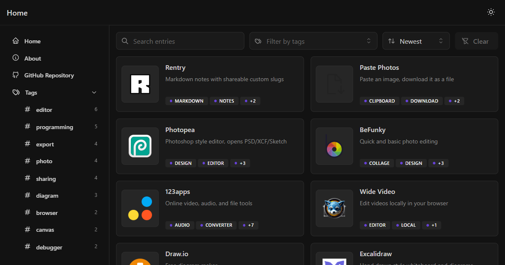

<h1 align="center">Bnjmzzn's Bookmarks</h1>

<p align="center">
A curated list of useful websites, filterable by tags and available as a public API.
</p>

<p align="center">
  
  
  
  
  
  
  
</p>

<p align="center">
  <a href="https://bnjmzzn-bookmark.vercel.app"><b>Live App</b></a> |
  <a href="https://bnjmzzn-bookmark.vercel.app/api/docs"><b>API Docs</b></a> |
  <a href="https://bnjmzzn-bookmark.vercel.app/about"><b>About</b></a>
</p>

<p align="center">
  
</p>

> [!NOTE]
> This is not a browser bookmark manager. It is a plain list of links that anyone can browse. It is a learning project built to practice fullstack development with Mantine, Neon, and Drizzle.

> [!WARNING]
> The site is maintained by one person and may go down, for example from free tier limits on Vercel or Neon. This app does not formally accept listing suggestions. 

## ✨ Features

- Browse a curated list of websites
- Filter entries by tags
- Public API for the full entry list, no key needed
- JSend formatted responses

## ⚓ Tech Stack

| Technology | Purpose |
| --- | --- |
| Vercel | hosting |
| Next.js | framework, routing, API routes |
| React | UI components |
| Mantine | component library, theming, notifications |
| Neon | serverless Postgres database |
| Drizzle ORM | schema, queries, migrations |
| drizzle-zod | schemas generated from the database tables |
| Zod | schema validation |
| TypeScript | type safety |
| Axios | HTTP client |
| react-markdown | markdown rendering |
| Tabler Icons | icons |
| Biome | linting, formatting |

## 👨‍🍳 Development

Requires Node 26 and pnpm 12. Clone the repo and install dependencies:

```bash
git clone <this repo>
cd bookmarks
pnpm install
```

Copy the example env file and fill in your Neon connection string:

```bash
cp .env.example .env
```

Run migrations and start the dev server:

```bash
pnpm db:migrate
pnpm dev
```

Other scripts:

| Script | Purpose |
| --- | --- |
| `pnpm format` | format with Biome |
| `pnpm db:generate` | generate migrations from the schema |
| `pnpm db:studio` | open Drizzle Studio, edit the database locally |

## 🧑‍⚖️ License

See [MIT LICENSE](/LICENSE)